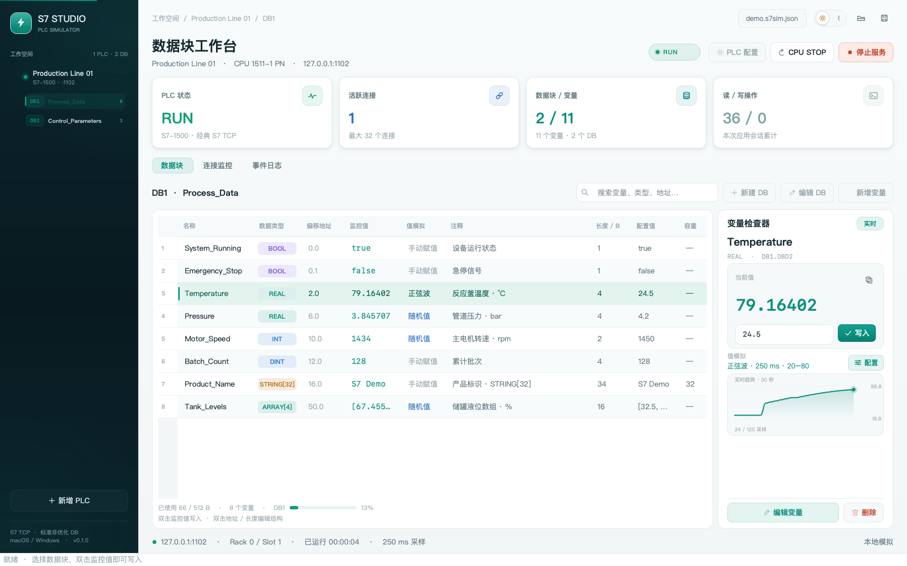
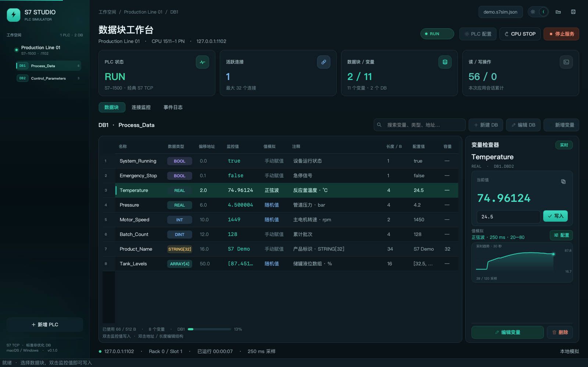

# S7 Studio

运行在 **macOS 和 Windows** 上的图形化 S7 通信与数据模拟器，使用 PySide6 + python-snap7。可以同时建立多台虚拟 PLC，让上位机、采集程序或测试脚本通过真实 S7 TCP 连接读写 DB。

**下载应用：[GitHub Releases](https://github.com/WendelYu/S7Simulator/releases/latest)**。Mac 提供 Apple Silicon / Intel 的 DMG 和 ZIP，Windows 提供 x64 安装程序和便携 ZIP，文件名均含版本号。不需要安装 Python。

Mac 用户请先阅读 [安装与“已损坏／移到废纸篓”提示处理](docs/MAC_INSTALL.md)；每个 Release 也包含完整操作说明和 SHA256 校验文件。当前应用未经过 Apple 公证或 Windows 商业代码签名。



## 已实现

- 多台 PLC：S7-300、S7-400、S7-1200、S7-1500 配置预设与模拟 CPU 身份，每台独立监听 IPv4 / TCP 端口，可限制连接数。
- 图形化 DB 管理：新增、编辑、复制、删除 DB，自定义编号、名称、容量（最多 65536 B）。
- 变量管理：新增、修改、删除，自动生成绝对地址，支持标量及一维数组。
- 类型：BOOL、BYTE、WORD、DWORD、LWORD、SINT、USINT、INT、UINT、DINT、UDINT、LINT、ULINT、REAL、LREAL、CHAR、WCHAR、STRING、WSTRING、TIME、DATE、TOD、DATE_AND_TIME。
- 实时数值：双击表格值或通过检查器写入；客户端写入同步到界面。非有限浮点值、越界和非法字符串会被拒绝。
- 值模拟：数值随机、正弦波、递增斜坡；BOOL 随机和定时翻转。可配置范围、更新间隔、波形周期，运行中修改规则。
- CPU RUN / STOP：STOP 暂停自动值模拟，TCP 服务继续监听。
- 连接监控：每条连接的 IP、端口、状态、时间、读写次数和字节数；保留最近 1000 条会话。
- 事件日志：连接、断开、读写、手动修改、启动错误；内存保留最近 2000 条，可导出 CSV。
- JSON 项目保存、加载，保存当前有效值与模拟规则；DB 定义导出 CSV。
- macOS `.app` 和 Windows 便携程序构建脚本及 GitHub Actions 流程。
- 浅色 / 深色 / 跟随系统外观，主题与动效偏好持久化；自绘导航、标签、卡片、趋势图与 Toast，支持关闭动效。

## 界面与动效

界面使用统一的主题令牌和自绘组件，不依赖平台默认控件外观。浅色、深色与跟随系统外观会写入设置，下次启动恢复；切换主题时窗口内容交叉淡入。

- **导航与标签**：侧栏选中项滑行高亮，标签胶囊指示器平滑移动；树节点展开/收起有短过渡。
- **实时反馈**：PLC 状态呼吸点、监控值闪变与弹入、趋势首帧揭示、悬停十字线读数、写入和保存操作的 Toast。
- **克制的节奏**：动画时长约 120–560 ms，全部非阻塞，不影响 250 ms 数据刷新；`外观 → 启用界面动效` 可关闭并记忆，也可用 `--no-motion` 启动。
- **可读性细节**：类型与模拟模式彩色标签、变量容量用量条、表格空状态引导、对话框内嵌错误提示、回车直接写入。
- **快捷管理**：右键 PLC 可启动/停止服务、新建 DB、导入点位和删除；右键 DB 可编辑、复制、新增变量和删除。选中树节点后也可按 Delete 删除，确认框默认取消；运行中结构操作禁用。
- **精细表单**：统一输入框高度与标签对齐、清晰的下拉和步进箭头、按模拟模式展示有效参数；长表单可滚动，确认按钮始终位于底部。数字框与下拉框未聚焦时，滚轮只滚动页面。




## 启动

开发运行需要 Python 3.11 或更新版本。首次启动加载示例项目，服务默认停止。

### macOS

双击 `start-macos.command`，或：

```bash
python3 -m venv .venv
source .venv/bin/activate
python -m pip install -e '.[dev]'
python -m s7sim
```

### Windows

双击 `start-windows.bat`，或在 PowerShell 中：

```powershell
py -3 -m venv .venv
.venv\Scripts\python.exe -m pip install -e ".[dev]"
.venv\Scripts\python.exe -m s7sim
```

也可使用 uv：`uv sync --extra dev`，然后 `uv run python -m s7sim`。

打开指定项目：`python -m s7sim examples/demo.s7sim.json`。

外观也可以用命令行覆盖：`python -m s7sim --theme dark`，或 `python -m s7sim --no-motion` 关闭动效。

## 连接客户端

1. 点击「启动服务」。示例监听 `127.0.0.1:1102`，建议 Rack `0` / Slot `1`。
2. 用工作台显示的绝对地址读写，例如 `DB1.DBD2` 对应 Temperature。
3. 运行示例：

```bash
python examples/client.py --watch
```

最小 Python 客户端：

```python
import snap7

client = snap7.Client()
try:
    client.connect("127.0.0.1", 0, 1, tcp_port=1102)
    print(client.db_read(1, 0, 16).hex(" "))
finally:
    client.disconnect()
    client.destroy()
```

支持自定义端口的经典 S7 客户端可以接入。需要通过 S7.Net、Sharp7、HslCommunication 等进行连接时，请在客户端配置相同端口；这些第三方客户端尚未逐一实测。不支持修改端口的客户端可使用 `102`，能否监听取决于操作系统权限和端口占用。

局域网访问：将监听地址改为 `0.0.0.0`，客户端填写运行模拟器电脑的局域网 IPv4；必要时在系统防火墙中允许该端口。每台 PLC 使用不同的端口或不同的本地 IP。

## 布局与数据

- 非优化标准 DB，大端字节序；连续 BOOL 按位打包；其他多字节类型在偶数字节起始。修改变量结构可能改变后续地址，因此运行中禁止修改结构。
- 数组输入为 JSON，例如 `[1, 2, 3]`。BOOL 数组按位连续存储，其他数组按元素连续存储。当前不支持 STRUCT、UDT 和嵌套数组。
- STRING 使用 Latin-1，容量 1–254 字节；WSTRING 使用 UTF-16 BE，容量按 UTF-16 码元计，中文使用 WSTRING。
- TIME 为有符号毫秒，TOD 为午夜起毫秒，DATE 为自 1990-01-01 起的天数（图形输入也接受 YYYY-MM-DD），DATE_AND_TIME 为 Siemens 8 字节 BCD，输入 ISO 日期时间，年份 1990–2089。
- 值模拟只在服务运行且 CPU RUN 时执行；自动模拟会在下次更新时覆盖手动或客户端写入。需要保留写值时，将变量改为「手动赋值」。
- 停止服务保留 DB 当前内存。保存项目包含当前可解码的值及模拟规则；客户端写入无效日期等不可解码字节时，界面显示错误，保存时保留该变量最近有效的配置值。
- 只有显式保存才写项目文件；模拟值与客户端写入不逐次标记未保存状态。希望保存运行结果时请点击保存。
- 波形按单个 PLC 的运行时间计算，共用相位；数组随机逐项生成。趋势显示最近 120 个界面采样点，数组显示首个元素；BOOL 以 ON/OFF 阶梯绘制，悬停可查看具体采样值和采样时间。
- 连接数统计 TCP 会话，包括尚未完成 S7 握手的连接；读写统计为成功的内存区域操作，不是网络包数。统计及日志在重新打开项目后重置。

## 功能边界

这是用于上位机联调的**通信与数据模拟器**。型号、CPU 名称、Rack / Slot 是配置预设；SZL CPU 信息返回预设 CPU 名称与模拟序列号，订货号为 `SIM-S7-xxxx`。底层使用通用经典 S7 服务，不仿真对应型号的固件、硬件资源上限或真实硬件身份，服务不强制校验 TSAP。

不执行梯形图、STL、SCL，不运行或验证 TIA 工程，不提供 S7 Plus、优化 DB、OPC UA、真实 I/O 或扫描周期仿真。当前界面仅管理 DB，未开放 I/Q/M、定时器、计数器区域。

底层协议与兼容范围参见 [python-snap7 官方说明](https://github.com/gijzelaerr/python-snap7) 和 [S7 Server 文档](https://python-snap7.readthedocs.io/en/3.2.1/API/server.html)。Qt 官方提供 [跨平台桌面部署说明](https://doc.qt.io/qtforpython-6/deployment/index.html)。

## 测试

```bash
python -m pytest -q
```

测试包含二进制布局、所有类型的标量 / 数组、项目持久化、真实回环 S7 TCP 读写、多客户端、多 PLC 隔离、随机模拟、CPU STOP、端口冲突、空闲连接停止与重启，以及 Qt 界面操作（含主题模式、空状态可读性与帮助对话框）。运行环境需要允许监听本机临时 TCP 端口。

GitHub Actions 在 macOS Apple Silicon、macOS Intel 和 Windows x64 上运行完整测试。推送版本标签时，还会构建原生安装包、独立启动打包程序并检查界面截图和版本信息，全部成功后才发布 Release。云端执行结果可在仓库 Actions 中查看；这不能代替每个操作系统版本的人工界面测试。

## 打包

需要在目标操作系统构建。安装开发依赖后：

```bash
python scripts/build.py
```

- macOS：`dist/S7 Studio.app`、`dist/S7Studio-v0.1.0-macos-arm64.dmg` 和同名前缀的 ZIP；Intel 构建的架构为 `x64`。DMG 提供 Applications 快捷方式和安装说明。要求 macOS 14 或更新版本。
- Windows：`dist/S7 Studio/S7 Studio.exe`、`dist/S7Studio-v0.1.0-windows-x64.zip` 和 `dist/S7Studio-v0.1.0-windows-x64-setup.exe`。需安装 [Inno Setup 6](https://jrsoftware.org/isinfo.php)，GitHub Windows runner 已预装。安装程序在当前用户目录安装，支持快捷方式和系统卸载。
- 每个 DMG、ZIP、安装 EXE 都有同名 `.sha256` 校验文件；Release 另外提供 `SHA256SUMS.txt`。Windows 便携版必须完整解压，不能单独拷贝 EXE。
- 当前构建使用本机架构。macOS 构建为本地 ad-hoc 签名，未进行 Apple 公证；Windows 构建未配置代码签名。
- `.github/workflows/build.yml` 在原生架构分别构建，本地 Mac 不能直接生成 Windows 可执行文件。

## 自动发布到 GitHub Release

版本号统一维护在 `s7sim/__init__.py` 的 `__version__`；Python 包、应用侧栏、macOS Info.plist、Windows EXE 版本资源、安装程序和附件文件名均使用该版本。

1. 将 `__version__` 更新为如 `0.1.1`，并在 `CHANGELOG.md` 新增 `## [0.1.1]` 的更新记录。
2. 提交并推送代码，再推送对应标签：

   ```bash
   git add s7sim/__init__.py CHANGELOG.md
   git commit -m "Release v0.1.1"
   git push origin main
   git tag -a v0.1.1 -m "S7 Studio v0.1.1"
   git push origin v0.1.1
   ```

3. Actions 验证标签与源码版本一致，在三个原生 runner 上测试、打包并启动程序，然后检查六个分发包及 SHA256，最后创建草稿、上传完整附件并发布正式 Release。

主分支和 PR 执行测试；Actions 的 `Run workflow` 可手动测试并构建附件，不会发布 Release。任意测试、构建或校验失败都不会发布不完整版本。发布任务只使用 GitHub 自带的 `GITHUB_TOKEN`，无需保存个人 Token 到仓库；已发布版本不覆盖，修复后应递增版本号。

Release 正文从 `docs/RELEASE_TEMPLATE.md` 和对应 `CHANGELOG.md` 生成，包含每个平台的下载选择、安装步骤、Mac 拦截提示处理及校验命令。

## 代码结构

```text
s7sim/codec.py      标准 DB 布局与字节编解码
s7sim/models.py     PLC / DB / 变量模型与项目持久化
s7sim/engine.py     S7 服务、连接观察、独立模拟线程
s7sim/theme.py      主题令牌、明暗配色与统一 QSS
s7sim/icons.py      自绘矢量图标
s7sim/motion.py     动效开关、缓动与阴影/淡入工具
s7sim/widgets.py    自绘组件、趋势绘图、Toast
s7sim/dialogs.py    配置对话框
s7sim/window.py     主界面与项目操作
tests/             单元测试、协议集成测试、Qt 界面测试
scripts/build.py   原生应用构建与归档
```

协议连接监控适配层使用了 python-snap7 的少量内部接口，因此依赖固定为 `3.2.1`；升级时应重新运行协议集成测试。

## DB 编辑器更新

DB 表格增加行号、偏移、长度和起始值列，支持调整列宽与拖动列顺序。停止 PLC 后双击「偏移地址」输入 `20.0`，BOOL 可输入 `0.3`；留空恢复自动布局。双击「长度 / B」设置预留字节数，输入 `0` 恢复按类型计算。预留长度不能小于数据所需大小，重叠地址及超出 DB 容量会被拒绝，原配置保留。

变量对话框可分别设置预留存储长度、字符串容量和数组元素数。多字节变量的手动地址可不对齐，自动地址仍按偶数字节对齐；自动变量排在此前已分配区域的最高地址之后。监控值变化后显示淡绿色渐退反馈。

## 类型编辑、主题与动效

双击「数据类型」使用下拉框切换类型，切换后数值和模拟规则重置为默认值。String/WString 的容量在「容量」列直接编辑，单位为字符编码单元；容量不足以容纳当前字符串时保留原配置并提示错误。「长度 / B」仍表示预留存储空间，两者独立。

顶部的太阳 / 月亮开关及「外观」菜单提供浅色、深色与跟随系统三种外观；选择会持久化，下次启动恢复。切换主题时窗口内容交叉淡入，可在「外观」中关闭「启用界面动效」。新增 PLC 自动建议未被当前项目和系统占用的端口；同一个 IP 可以配不同端口，IP + 端口构成唯一监听地址。最终端口占用仍在启动服务时检查。

## 批量导入测试点位

在当前 PLC 停止时点击 DB 工具栏「导入点位」，或文件菜单「批量导入点位」。窗口内可保存 CSV 模板、打开 CSV/TSV，或直接粘贴从 Excel 复制的含标题单元格；不直接读取 .xlsx 文件。仓库内模板为 `examples/points-template.csv`。

最少保留「DB编号」「变量名」「数据类型」三列，其余列可留空。默认 DB 容量 512 B、数组数量 1、字符串容量 32、初始值为类型默认值、模拟模式为手动、更新间隔 1000 ms。偏移留空自动编排；手动偏移用 `20.0` 或 BOOL 的 `0.3`。模拟模式可填手动、随机、正弦、斜坡、翻转，或 manual/random/sine/ramp/toggle。数组初始值用 JSON；用表格软件另存为 CSV 可自动处理逗号引号。

导入到选定 PLC，同编号 DB 追加变量，不存在的 DB 自动创建；已有 DB 的名称和容量可留空沿用，填写时必须一致。重复变量、地址重叠、超容量、非法初始值和模拟规则会显示源行号。先「校验并预览」，全部通过后「确认导入」。任何错误都会阻止整批应用；修改输入后需重新校验。支持 UTF-8 / UTF-8 BOM 与 GB18030 编码，单次最多 10000 点、5 MB；预览只展示前 500 点，确认应用全部有效点。

## 保存与模拟体验更新（2026-10-24）

- 「文件 → 项目保存设置」可配置默认目录，下次启动继续生效。默认使用操作系统的文档目录下 `S7 Studio`，不再依赖程序启动目录。已有文件继续保存在原位置；新项目建议文件名会避开同名文件，目录不可用时显示错误，不丢失当前项目。使用 Qt 原生目录与配置存储兼容 macOS / Windows，Windows 实机验证仍需在目标环境执行。
- BOOL 标量在变量表、检查器和新增/编辑对话框中使用 true/false 选择器；BOOL 数组使用 JSON。
- 检查器显示「等待启动服务」「CPU 已暂停」「模拟中」，并提供启动服务/恢复 CPU RUN 按钮；启动会运行当前 PLC 的所有自动模拟规则。随机 BOOL 可能连续取到同值，确定交替变化请使用定时翻转。
- 波形更新间隔必须小于周期。界面每 250 ms 采样，快于此频率的更新不会逐次显示，外部客户端可以独立读取。
- 手动写值后如仍启用自动模拟，会提示下一次更新覆盖。需要固定数值，请配置为手动赋值。
- 数据页无需每次复制连接/事件历史；长字符串和数组的复制按钮复制完整值。保存后配置值列同步保存快照。
