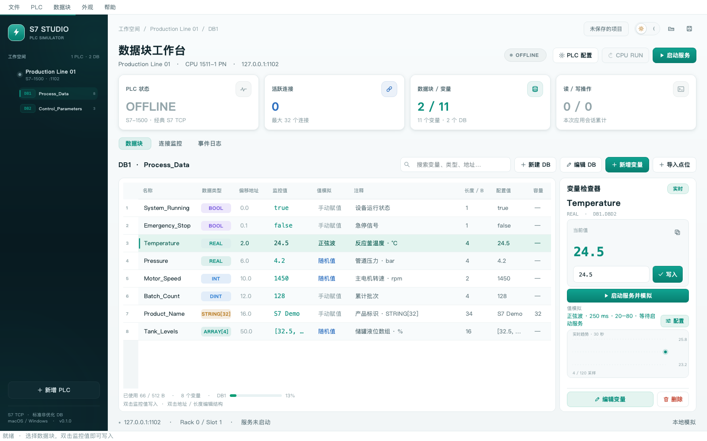
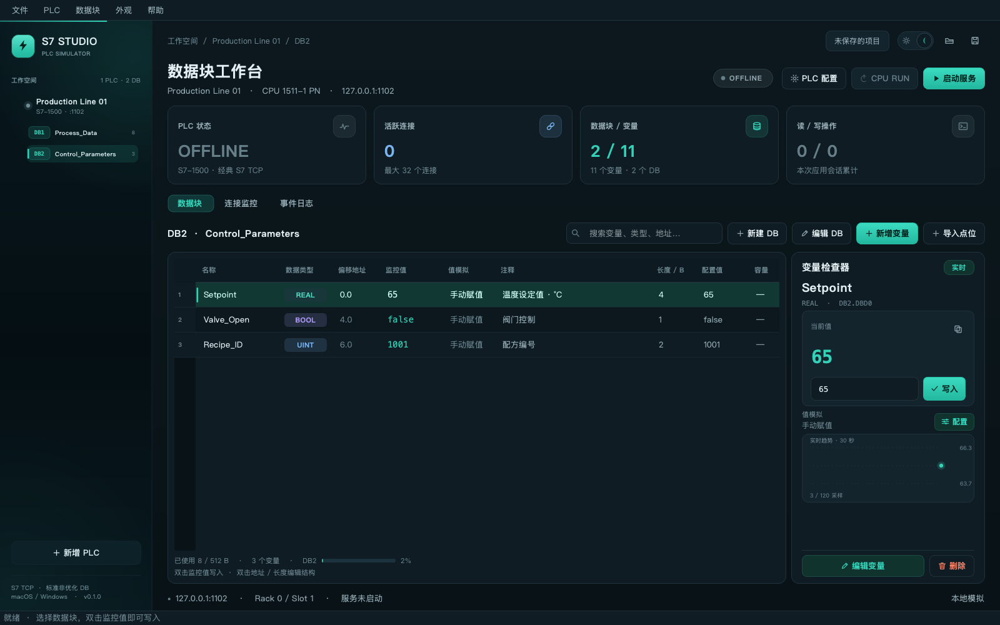
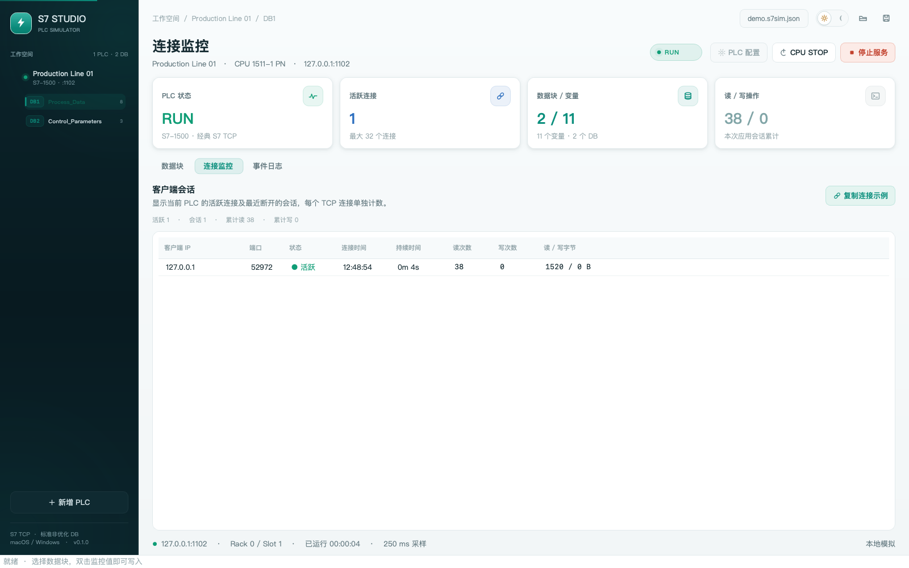

# S7 Studio

运行在 **macOS 和 Windows** 上的图形化 S7 PLC 通信与数据模拟器。无需真实 PLC，即可建立多台虚拟控制器、编辑 DB 点位，并通过经典 S7 TCP 连接测试上位机、采集程序和客户端。

**[下载最新版](https://github.com/WendelYu/S7Simulator/releases/latest)** · **[更新记录](CHANGELOG.md)** · **[点位导入模板](examples/points-template.csv)** · **[反馈问题](https://github.com/WendelYu/S7Simulator/issues)**

适用于通信联调和测试数据生成。型号选项提供 CPU 配置预设与模拟身份；本项目不执行 PLC 程序，也不运行 TIA 工程。



## 下载与安装

安装包内已包含运行环境，**使用应用不需要安装 Python**。

### macOS 14 及以上

在 [Release 下载页](https://github.com/WendelYu/S7Simulator/releases/latest) 根据芯片选择安装包：

- **Apple Silicon（M 系列）**：文件名包含 `macos-arm64` 的 DMG 或 ZIP。
- **Intel Mac**：文件名包含 `macos-x64` 的 DMG 或 ZIP。

打开 DMG，将 `S7 Studio.app` 拖入 `Applications`（应用程序），然后推出磁盘映像。ZIP 用户先解压，再将 `.app` 拖入“应用程序”。通过“苹果菜单 → 关于本机”可以查看芯片或处理器型号。

当前 Mac 应用采用 ad-hoc 签名，未经过 Apple 公证。首次打开若提示“无法验证开发者”，先尝试打开一次，再进入“系统设置 → 隐私与安全性”，找到 S7 Studio 并点击“仍要打开”。

**提示“已损坏，无法打开，你应该将它移到废纸篓”？**

先点“取消”或“完成”，按[完整安装与排查说明](docs/MAC_INSTALL.md)确认下载来源、架构、SHA256 和签名完整性。仅在确认是可信且完整的本项目应用，仍因下载隔离属性被拦截时，才运行：

```bash
xattr -dr com.apple.quarantine "/Applications/S7 Studio.app"
open "/Applications/S7 Studio.app"
```

安装到其他目录时，请替换实际路径。校验不通过或签名损坏时应重新下载，不要绕过检查；无需关闭系统全局安全检查。

### Windows 10 / 11 x64

- **安装版**：下载文件名以 `windows-x64-setup.exe` 结尾的安装程序，双击后按向导安装。默认安装到当前用户目录，无需管理员权限，支持快捷方式和系统卸载。
- **便携版**：下载文件名以 `windows-x64.zip` 结尾的压缩包，完整解压后运行 `S7 Studio/S7 Studio.exe`。请保留 `_internal` 等同目录文件，不要只复制 EXE。

Windows 应用尚未配置 Authenticode 签名。如果 SmartScreen 提示无法识别应用，先核对来源和 SHA256，仅在确认信任后选择“更多信息 → 仍要运行”；企业策略阻止时请联系管理员。

### 校验下载文件

分发包文件名包含版本号，例如 `S7Studio-v0.1.0-macos-arm64.dmg`。每个包都附带同名 `.sha256` 文件，Release 另提供汇总 `SHA256SUMS.txt`。GitHub 附带的 `Source code` 是源码，不是安装包。

以下以 v0.1.0 为例，其他版本请替换文件名。Mac 下载 DMG 和对应 `.sha256` 后，在终端执行，应显示 `OK`：

```bash
cd ~/Downloads
shasum -a 256 -c S7Studio-v0.1.0-macos-arm64.dmg.sha256
```

Windows 可用 PowerShell 计算摘要，与 `SHA256SUMS.txt` 对照：

```powershell
Get-FileHash .\S7Studio-v0.1.0-windows-x64-setup.exe -Algorithm SHA256
```

## 主要功能

- **多 PLC 实例**：S7-300、S7-400、S7-1200、S7-1500 配置预设，独立监听 IPv4 / TCP 端口，可配置最大连接数。
- **图形化 DB 编辑**：新增、配置、复制和删除 DB；编辑变量类型、初始值、注释、数组数量、偏移地址、预留长度及字符串容量。单个 DB 最大 65536 B，自动检查重叠和越界。
- **实时读写与模拟**：手动写值、客户端写入同步显示；支持随机值、正弦波、递增斜坡和 BOOL 定时翻转，提供趋势图与模拟状态提示。
- **批量导入点位**：打开 CSV / TSV、粘贴 Excel 单元格或使用模板，先预览校验，再整批导入。
- **连接与事件监控**：查看客户端 IP、端口、连接时间、持续时间、读写次数和字节数；连接历史最多保留 1000 条，事件日志最多保留 2000 条，日志可导出 CSV。
- **项目保存**：JSON 项目保存与加载，自定义默认保存目录，保存当前有效值和模拟规则，支持导出 DB 定义。
- **明暗主题与交互**：浅色、深色、跟随系统，主题与动效偏好自动记忆；支持 PLC / DB 右键菜单、Delete 删除确认、长表单滚动和输入校验。

支持的数据类型：

- 布尔与位串：`BOOL`、`BYTE`、`WORD`、`DWORD`、`LWORD`。
- 整数：`SINT`、`USINT`、`INT`、`UINT`、`DINT`、`UDINT`、`LINT`、`ULINT`。
- 浮点：`REAL`、`LREAL`。
- 字符与字符串：`CHAR`、`WCHAR`、`STRING`、`WSTRING`。
- 时间与日期：`TIME`、`DATE`、`TOD`、`DATE_AND_TIME`。

以上类型支持标量及一维数组。BOOL 标量使用 `true / false` 选择器；数组值使用 JSON，例如 `[10, 20, 30]` 或 `[true, false]`。

<details>
<summary>查看深色工作台与连接监控</summary>





</details>

## 快速上手

1. **选择或新增 PLC**：首次启动加载示例项目，服务默认停止。可右键 PLC 进行配置；示例监听 `127.0.0.1:1102`，Rack 为 `0`，Slot 为 `1`。
2. **准备 DB 点位**：使用示例 DB，或新建数据块并添加变量。也可以点击“导入点位”快速生成测试数据。
3. **启动服务**：点击“启动服务”，按工作台显示的 IP、端口和 DB 地址连接客户端。
4. **写入或模拟值**：双击表格“监控值”，或在变量检查器中选择 / 输入新值后点击“写入”；通过“值模拟 → 配置”设置自动变化规则。
5. **查看连接与保存**：在“连接监控”和“事件日志”中观察读写，完成配置后通过“文件 → 保存”保存项目。

同一台电脑上创建多个 PLC 时，可使用相同 IP 和不同 TCP 端口。新增 PLC 会建议未被当前项目和系统占用的端口，最终占用情况仍在启动服务时检查。

### 地址、长度与类型编辑

修改 PLC、DB 或变量结构前，先停止对应 PLC 的服务。

- 双击“偏移地址”输入 `20.0`，BOOL 可输入 `0.3`；留空恢复自动分配。
- 双击“长度 / B”设置预留字节数，输入 `0` 恢复按类型计算；预留长度不能小于实际所需空间。
- 双击“数据类型”切换类型；修改后数值与模拟规则会重置为默认值。
- `STRING / WSTRING` 的“容量”表示最大字符编码单元数，与“长度 / B”的预留空间独立。也可以在变量对话框中编辑这些配置。

自动布局采用大端字节序，连续 BOOL 按位打包，其他多字节类型在偶数字节起始。手动指定的多字节地址可以不对齐；重叠地址或超出 DB 容量会被拒绝。修改结构可能改变后续自动地址，需要保持固定地址时可设置手动偏移和预留空间。

### 动态模拟与手动写值

自动模拟需要同时满足：**服务已启动、CPU 为 RUN、变量配置了自动模拟模式**。

- 数值类型支持随机、正弦波和递增斜坡；BOOL 支持随机或定时翻转。
- 随机 BOOL 可能连续得到相同值。需要稳定交替变化时，请选择“定时翻转”。
- “CPU STOP”只暂停自动模拟，TCP 服务仍可连接和读写；“停止服务”关闭连接，并保留当前 DB 内存。
- 手动或客户端写入后，自动模拟会在下一次更新时覆盖该值。需要保持写值时，请改为“手动赋值”。
- 正弦与斜坡的更新间隔必须小于完整周期。数组随机值逐项生成，波形模式同步更新各元素。

界面每 250 ms 刷新，趋势显示最近 120 个界面采样点；数组趋势显示首个元素。快于界面采样的变化不一定逐次显示，外部客户端可独立读取。

### 批量导入点位

停止当前 PLC 后，点击 DB 工具栏“导入点位”，或使用文件菜单中的“批量导入点位”。支持打开 CSV / TSV，或直接粘贴从 Excel 复制的含标题单元格；不直接读取 `.xlsx`。

完整模板见 [examples/points-template.csv](examples/points-template.csv)，窗口内也可保存模板。只需保留“DB编号”“变量名”“数据类型”三列，其余列按需添加。例如：

```csv
DB编号,变量名,数据类型,偏移,初始值,模拟模式,下限,上限,间隔ms
10,Running,BOOL,0.0,true,翻转,,,1000
10,Temperature,REAL,2.0,25.5,随机,20,80,500
```

导入时，同编号 DB 追加点位，不存在的 DB 自动创建。偏移留空自动编排；已有 DB 的名称和容量可留空沿用，填写时必须与现有定义一致。

先点击“校验并预览”，全部通过后再“确认导入”。重复名称、地址重叠、超容量或非法初始值会显示源行号；任一错误都会阻止整批应用，修改内容后需重新校验。

- 默认新 DB 容量 512 B、数组数量 1、字符串容量 32、初始值为类型默认值、模拟模式为手动、更新间隔 1000 ms。
- 模拟模式可填“手动、随机、正弦、斜坡、翻转”，或 `manual / random / sine / ramp / toggle`。
- 支持 UTF-8、UTF-8 BOM 和 GB18030 编码；单次最多 10000 点、5 MB，预览最多显示 500 行，确认时导入全部有效点位。
- 数组初始值使用 JSON；CSV 中包含逗号的数组或文本需要正确加引号，可通过表格软件另存为 CSV 处理。

### 项目保存、更新与卸载

通过“文件 → 项目保存设置”指定默认目录，设置会保留到下次启动。默认目录是系统“文稿 / 文档”下的 `S7 Studio` 文件夹；已有项目继续保存到原文件，新项目建议文件名会避开同名文件。

项目保存包含当前可解码的值与模拟规则。客户端写入无效日期等不可解码字节时，界面显示错误，保存时保留该变量最近有效的配置值。自动模拟和客户端写入不会逐次标记项目未保存，希望保留运行结果时请主动保存。

升级前先退出应用：Mac 用新 `.app` 替换旧版本，Windows 运行新版安装程序或使用新便携文件夹。卸载时，Mac 将 `.app` 移到废纸篓，Windows 安装版通过系统“已安装的应用”卸载。项目 JSON 是独立文件，更新和卸载不会主动删除项目。

## 连接客户端

启动示例 PLC 后，可使用支持自定义端口的经典 S7 客户端连接。项目提供 [Python 读写示例](examples/client.py)。在源码仓库目录中，先为客户端环境安装依赖，再运行示例：

```bash
python -m pip install "python-snap7==3.2.1"
python examples/client.py --watch
```

读取示例 DB 中的 Temperature（`DB1.DBD2`，`REAL`）：

```python
import struct
import snap7

client = snap7.Client()
try:
    client.connect("127.0.0.1", 0, 1, tcp_port=1102)
    raw = client.db_read(1, 2, 4)
    print("Temperature:", struct.unpack(">f", raw)[0])
finally:
    client.disconnect()
    client.destroy()
```

局域网访问时，将 PLC 监听地址改为 `0.0.0.0`，客户端填写运行模拟器电脑的局域网 IPv4，并按需放行系统防火墙端口。`0.0.0.0` 是监听配置，不是客户端连接地址。

S7.Net、Sharp7、HslCommunication 等第三方客户端尚未逐一实测，应配置与模拟器相同的 IP、TCP 端口和 DB 地址。不支持自定义端口的客户端可尝试使用 `102`，能否监听取决于系统权限和端口占用。

连接数统计 TCP 会话，包括尚未完成 S7 握手的连接；读写统计为成功的内存区域操作，不是网络包数。统计和日志在重新打开项目后重置。

## 数据约定与功能边界

- `STRING` 使用 Latin-1，容量为 1–254 字节；`WSTRING` 使用 UTF-16 BE，容量按 UTF-16 码元计，中文内容请使用 `WSTRING`。
- `TIME` 使用有符号毫秒；`TOD` 表示午夜起毫秒；`DATE` 表示自 1990-01-01 起的天数，图形输入也接受 `YYYY-MM-DD`。
- `DATE_AND_TIME` 使用 Siemens 8 字节 BCD，输入 ISO 日期时间，支持年份 1990–2089。
- 支持经典 S7 的标准非优化 DB；不支持 STRUCT、UDT、嵌套数组、优化 DB、S7 Plus、OPC UA。
- 不执行梯形图、STL、SCL，不运行或验证 TIA 工程，也不仿真真实 I/O 或 PLC 扫描周期。当前界面只管理 DB，未开放 I/Q/M、定时器和计数器区域。
- 型号、CPU 名称、Rack / Slot 是配置预设；SZL 返回模拟 CPU 信息，订货号为 `SIM-S7-xxxx`。不仿真对应型号固件、硬件资源上限或真实硬件身份，服务不强制校验 TSAP。

## 从源码运行

需要 Python 3.11 或更新版本，界面基于 PySide6，通信使用 python-snap7。先克隆仓库：

```bash
git clone https://github.com/WendelYu/S7Simulator.git
cd S7Simulator
```

macOS 可双击 `start-macos.command`，或在终端执行：

```bash
python3 -m venv .venv
source .venv/bin/activate
python -m pip install -e '.[dev]'
python -m s7sim
```

Windows 可双击 `start-windows.bat`，或在 PowerShell 中执行：

```powershell
py -3 -m venv .venv
.venv\Scripts\python.exe -m pip install -e ".[dev]"
.venv\Scripts\python.exe -m s7sim
```

也可使用 uv：

```bash
uv sync --extra dev
uv run python -m s7sim
```

命令行示例：

```bash
python -m s7sim examples/demo.s7sim.json
python -m s7sim --theme dark
python -m s7sim --theme auto
python -m s7sim --no-motion
```

### 测试与本地打包

安装开发依赖后运行：

```bash
python -m pytest -q
python scripts/build.py
python scripts/smoke.py
```

测试包含数据编码、内存布局、项目保存、模板导入、真实 S7 TCP 读写、多客户端、CPU 状态、停服与重启、界面交互及分发包完整性逻辑。运行测试需要允许监听本机临时 TCP 端口。

打包需要在目标系统和架构上执行：

- Mac 输出 `dist/S7 Studio.app`、带版本号和架构的 DMG / ZIP，以及对应 `.sha256` 文件。
- Windows x64 输出 `dist/S7 Studio/S7 Studio.exe`、带版本号的安装 EXE / 便携 ZIP，以及对应 `.sha256` 文件；生成安装程序还需要 [Inno Setup 6](https://jrsoftware.org/isinfo.php)。

版本号维护在 `s7sim/__init__.py` 的 `__version__`，应用信息与分发包名称使用同一版本。详细变更见 [CHANGELOG.md](CHANGELOG.md)。

### 代码结构

```text
s7sim/codec.py          数据编码、解码与 DB 地址布局
s7sim/models.py         PLC / DB / 变量模型和项目文件
s7sim/engine.py         S7 服务、连接监控与独立模拟线程
s7sim/point_import.py   CSV / TSV 点位导入与校验
s7sim/storage.py        默认保存目录和项目文件名
s7sim/theme.py          深浅主题与统一样式
s7sim/widgets.py        导航、卡片、趋势图与反馈组件
s7sim/dialogs.py        PLC / DB / 变量 / 模拟配置
s7sim/window.py         主窗口与交互
examples/              示例项目、客户端与导入模板
packaging/             原生应用与 Windows 安装配置
scripts/build.py       本地构建与校验和生成
scripts/smoke.py       打包程序启动与版本检查
tests/                 数据、协议、界面和发布校验测试
```

协议适配使用了 python-snap7 的少量内部接口，因此固定为 `3.2.1`；升级该依赖时应重新运行协议集成测试。
